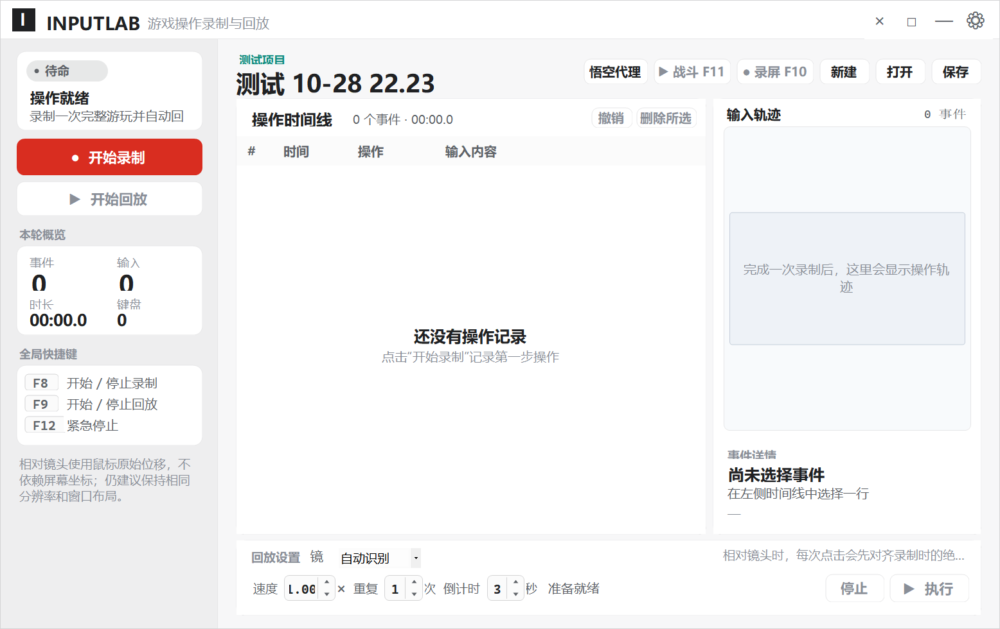
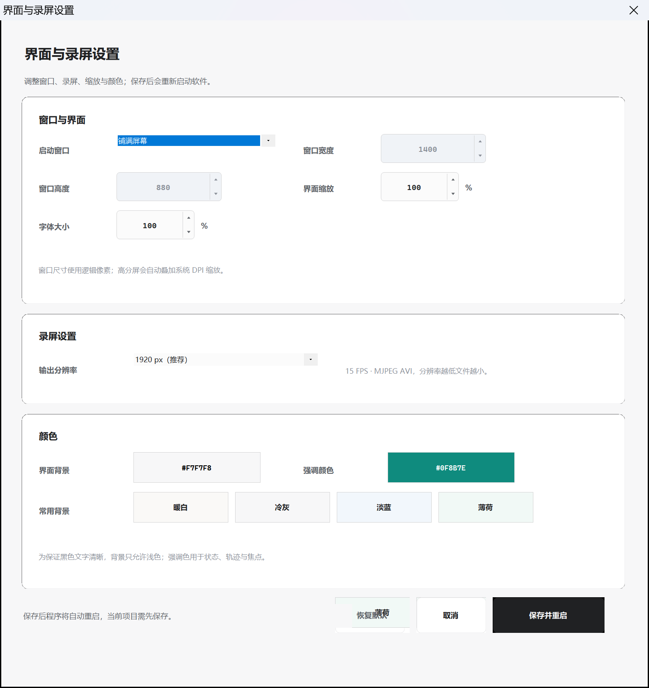
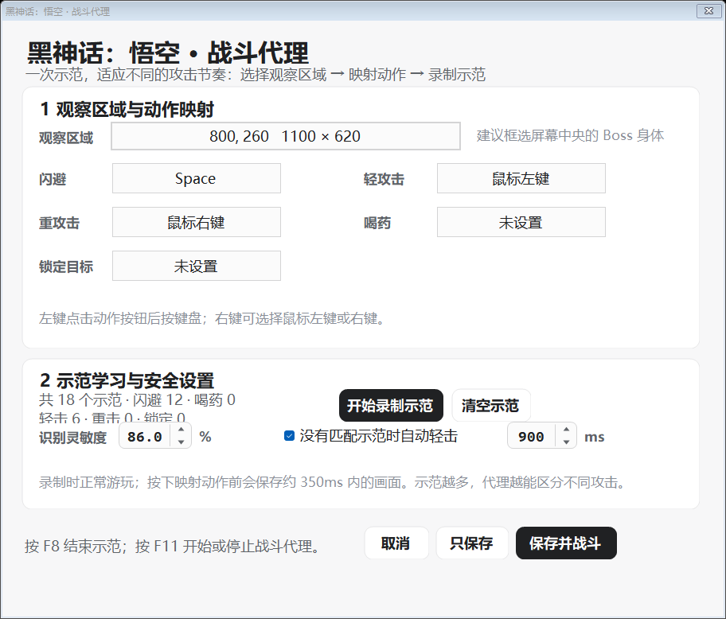

# 游戏输入实验室

一个用于 Windows 游戏回归测试的本地桌面工具。它记录你实际游玩时的鼠标移动、鼠标按键、滚轮、键盘按下与释放，再按原始时间节奏自动回放到游戏中。



## 功能

- 明亮界面：采用近白工作区、浅灰侧栏和白色圆角卡片，整体字体再次放大；启动后默认最大化到当前屏幕可用区域。
- 高分屏适配：控件布局和像素字号会按 Windows DPI 比例同步缩放，保持相同的信息密度和可读性。
- 自定义设置：可调整启动窗口尺寸、界面缩放、字号、录屏分辨率、背景色和强调色，设置保存在本机。
- 全局键鼠录制：即使工具已最小化，也能继续捕获游戏输入。
- 开放世界镜头：通过 Raw Input 捕获鼠标相对位移，支持自动识别和相对镜头回放。
- 点击位置锚定：相对镜头回放时，每个鼠标按下与释放都会先对齐到录制时的绝对坐标，避免初始光标位置不同造成点击偏移。
- 黑神话战斗代理：一次映射动作并录制多轮战斗示范，软件自动学习动作前画面，在新战斗中根据实时画面选择闪避、攻击、喝药或锁定。
- 手动录屏：点击工具栏“录屏 F10”或按 `F10` 开始/停止录制主显示器，生成 MJPEG AVI 视频。
- 高精度回放：使用 Windows `SendInput` 与键盘扫描码，支持 `0.25×` 到 `4×` 速度。
- 时间轴复查：查看每个事件的毫秒时间、鼠标坐标、按键名和滚轮增量。
- 步骤整理：支持批量删除、撤销删除、清空时间线和复制事件摘要。
- 项目文件：测试保存为可读的 `.gitproj.json` 文件，可重复打开和另存。
- 自动保存：每轮录制结束后保存到“文档\GameInputLab\Recordings”。
- 安全控制：`F12` 可在任意界面强制停止；单项目最多记录 250,000 个事件。
- 离线运行：没有网络请求，也不会把录制的按键或项目上传到外部服务。

## 快速开始

1. 双击根目录的 `启动软件.bat`。
2. 打开要测试的游戏，并进入每次测试都会重复的初始场景。
3. 回到本软件，点击“开始录制”。
4. 在 3 秒倒计时内切换回游戏，正常完成一轮操作。
5. 按 `F8` 结束录制。软件会恢复窗口并自动保存步骤。
6. 重新加载到相同场景，在“回放设置”的“镜头”中选择“自动识别”或“相对镜头”。
7. 点击“开始回放”或按 `F9`。
8. 需要立即中止时按 `F12`。

如果游戏以管理员身份运行，本软件也必须以管理员身份启动，否则 Windows 会阻止输入注入。

## 个性化设置

点击标题栏右侧的齿轮按钮打开设置：



- 启动窗口：选择铺满屏幕，或填写自定义逻辑宽高后居中启动。
- 界面缩放：在 `75%–150%` 范围内调整整套布局大小，系统 DPI 缩放会自动叠加。
- 字体大小：在 `80%–160%` 范围内单独调整文字大小。
- 录屏分辨率：可选原始、2560、1920、1280 或 960 像素宽度。
- 颜色：可自定义浅色背景和强调色，也可使用暖白、冷灰、淡蓝、薄荷预设。

保存设置后软件会自动重启。请先保存当前测试项目；录制、回放或屏幕录制进行期间不能修改设置。配置文件位于 `%LOCALAPPDATA%\GameInputLab\settings.json`。

## 屏幕录制

1. 点击项目工具栏中的“● 录屏 F10”，录屏会立即开始。
2. 切换到游戏完成需要保存的画面操作。
3. 按 `F10`，或恢复软件后点击“■ 停止录屏”结束录制。
4. 视频默认保存到“视频\GameInputLab”，文件名格式为 `录屏_yyyyMMdd_HHmmss.avi`。

录屏与输入记录、自动回放相互独立，可以单独录制手动游玩，也可以在自动测试时同步录屏。当前版本录制主显示器画面，帧率为 15 FPS，最长边自动限制为 1920 像素，不包含系统音频。

## 黑神话：悟空战斗代理

普通回放适合固定 UI 和确定性流程。面对攻击节奏变化的 Boss，应使用“悟空代理”的示范学习模式：



1. 点击项目工具栏中的“悟空代理”。
2. 点击“观察区域”，在锁定 Boss 后框选屏幕中央包含 Boss 身体和攻击动作的区域。
3. 映射闪避、轻击、重击、喝药和锁定目标；默认闪避为空格、轻击为鼠标左键、重击为鼠标右键。
4. 点击“开始录制示范”，按 `F8` 结束示范录制。建议正常游玩 2～4 次同一场 Boss 战。
5. 示范过程中按映射动作时，软件会自动保存动作前约 350ms 的画面，不需要手工标注攻击名称。
6. 保存后点击“▶ 战斗 F11”开始新测试，按 `F11` 停止。

运行时，软件会约每秒 20 次比较当前观察区域与示范画面，只有相似度达到设定阈值才执行对应动作。没有匹配到示范时，可选择按固定间隔自动轻击。开始时会自动执行已配置的锁定目标动作。

这是面向《黑神话：悟空》的视觉示范代理，不是内存读取或外挂。它适合单机、已授权的战斗测试。观察区域应尽量只包含 Boss 和攻击动作，避开波动的血条、粒子特效和频繁变化的背景。示范越多、场景越统一，识别越稳定。

## 快捷键

| 快捷键 | 空闲时 | 正在执行时 |
| --- | --- | --- |
| `F8` | 准备并开始录制 | 结束录制、恢复窗口并自动保存 |
| `F9` | 准备并开始回放 | 停止回放 |
| `F10` | 开始屏幕录制 | 停止并保存屏幕录制 |
| `F11` | 开始黑神话战斗代理 | 停止战斗代理 |
| `F12` | 无动作 | 取消准备或立即停止当前任务 |

## 本地构建

项目只依赖 Windows 自带的 .NET Framework 4.8。无需联网安装 NuGet 或 .NET SDK。

```powershell
powershell -NoProfile -ExecutionPolicy Bypass -File .\scripts\build.ps1 -Release
```

生成文件位于 `bin\GameInputLab.exe`。

运行存储层、全局输入钩子和 SendInput 回放测试：

```powershell
powershell -NoProfile -ExecutionPolicy Bypass -File .\scripts\test.ps1
```

## 兼容性说明

- 输入回放是标准 Windows 注入，不等于硬件级设备模拟。
- 使用独占 Raw Input、特殊驱动或反作弊保护的游戏可能忽略或拦截模拟输入。
- “自动识别”会在项目中存在相对镜头数据时选择相对鼠标回放；普通窗口操作可手动选择“绝对坐标”。
- 旧项目若没有 Raw Input 镜头数据，选择“相对镜头”时会根据历史光标轨迹推算位移；镜头锁定的游戏应重新录制。
- 截取坐标属于整个虚拟桌面。若游戏分辨率、窗口模式、窗口位置或 DPI 缩放变化，建议重新录制。
- 回放前应先进入与录制时大致相同的游戏状态；游戏加载时间差异可通过“开始延迟”补偿。
- 录屏使用 GDI 屏幕捕获；独占全屏游戏可能显示为黑屏，切换为无边框窗口模式通常可以正常录制。
- AVI 使用 MJPEG 编码，兼容常见播放器，但文件体积通常比 H.264 MP4 更大。
- 本工具用于获得授权的测试环境。请勿用于外挂、破坏游戏公平性或未经许可的自动操作。

## 项目结构

```text
src/
  Program.cs          程序入口与全局异常处理
  MainForm.cs         测试流程、项目管理与事件整理
  UiKit.cs            自绘按钮、状态卡、轨迹预览与提示
  Models.cs           录制事件和测试项目数据模型
  InputEngine.cs      Windows 全局钩子、节流与 SendInput 回放
  ScreenRecorder.cs   主显示器捕获、光标绘制与 MJPEG AVI 写入
  CombatModels.cs     战斗代理配置、动作映射和示范样本
  CombatDemoTrainer.cs 示范画面采集与动作前帧提取
  AdaptiveCombatAgent.cs 实时视觉匹配和战斗动作执行
  WukongAgentForm.cs 黑神话战斗代理配置向导
  StrategyEngine.cs   实时颜色感知、优先级规则和执行动作
  StrategyRulesForm.cs 智能策略编辑器与屏幕区域拾取
  AppSettings.cs      个性化设置模型、校验与本地持久化
  SettingsForm.cs     设置窗口
  PlaybackEventSelector.cs  绝对坐标与相对镜头事件筛选
  ProjectStore.cs     JSON 校验、原子保存和自动保存路径
tests/
  StorageTests.cs     项目文件往返与损坏文件测试
scripts/
  build.ps1           使用系统自带 csc 构建单文件程序
  test.ps1            编译并执行测试
```

## 当前限制

- 只支持相同或相近的桌面分辨率；暂不提供相对窗口坐标转换。
- 不捕获触控、手柄、摄像头或音频。
- 回放期间请勿手动操作键鼠，避免输入和目标游戏状态互相干扰。
- 快捷键不会被写入测试步骤。
